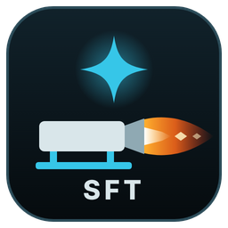

# SFT STELLAR — Stellar Kinetics Test Stand Console



A small, focused operator console for static-fire tests: **live pressure, ignition, cameras, recording.** Nothing else.

This branch (`teststand/console`) replaces the large all-in-one Stellar Ops system for test-stand work. The older code is unchanged on its own branches (`main`, `development/stellar-ops-v2`, `feature/*`).

## Sections — each one has its own job and its own code

| Section | Folder | Job | Knows about |
|---|---|---|---|
| Telemetry | `teststand/telemetry/` | Receives 200 Hz pressure from the ESP32 over Ethernet (TCP 9100) | nothing else |
| Ignition | `teststand/ignition/` | SAFE → ARMED → COUNTDOWN → FIRING, aborts, safety rules | "is telemetry live?" |
| Cameras | `teststand/cameras/` | Live preview + recording, each camera in its own FFmpeg process | nothing else |
| Recorder | `teststand/recorder/` | One folder per test: pressure CSV, video, event log, summary | telemetry, cameras |
| Web console | `teststand/web/` | The operator page and its API; no logic of its own | all (read + commands) |
| Firmware | `firmware/esp32_pressure_node/` | ESP32: pressure (`esp32_pressure_node.ino`) + ignition (`ignition.ino`) | — |

The sections are wired together in one place only: `teststand/app.py`.
A camera that freezes or disconnects cannot slow down pressure or ignition — cameras run as separate processes and restart by themselves.

## Install on Windows (no code needed)

1. Run `install/Install SFT STELLAR.bat` (double-click).
2. It installs Git/Python if missing, downloads SFT STELLAR from GitHub to `%USERPROFILE%\SFT STELLAR`, sets up Python, and creates **SFT STELLAR** icons on the Desktop and Start Menu.
3. Double-click the icon: the console starts in the background and opens in its own window.

**Updates:** press **Check for updates** in the top bar. It shows what is new and installs it with one click (only when ignition is SAFE and nothing is recording), then restarts. Your `config.yaml` and test data are never touched.
**Close:** the power button stops the console. Log file: `data/logs/console.log`.

## Start (developer)

```bash
pip install -r requirements.txt
cp config.example.yaml config.yaml      # Windows: copy config.example.yaml config.yaml
python -m teststand.app --config config.yaml
```

Open **http://localhost:5050**. On the ESP32 setup page (Wi-Fi `PressureMonitor` → `http://192.168.4.1`) the *Stellar Ops receiver IP* must be this PC's Ethernet IP (default `192.168.1.10`) and the port `9100`.

### Try it without hardware

```bash
python -m teststand.app                                 # terminal 1 (defaults: simulation ignition)
python -m teststand.telemetry.simulator --peak 45       # terminal 2: fake ESP32 with a simulated burn
```

To exercise the full ESP32 command path with the fake node, set `ignition.driver: esp32` in `config.yaml`.
Any local video file can be used as a camera (`url: test.mp4`) for screen checks.

## Firing sequence

1. **ARM** — confirm the three checks (range clear, igniter ready, sensors checked). Blocked if pressure telemetry is not LIVE.
2. **HOLD TO START COUNTDOWN** — hold for 1.5 s. Recording (pressure + all cameras) starts automatically.
3. Countdown runs (default 10 s). At T-0 the igniter gets one pulse (default 1000 ms).
4. System returns to **SAFE** by itself. Recording stops 30 s after the fire.

**ABORT** (button, `Esc` or `Space`) returns to SAFE at any time.

### Automatic aborts

| Condition | Where it is enforced |
|---|---|
| Pressure telemetry lost while ARMED / counting down | console |
| Operator page closed or frozen for 3 s while ARMED / counting down | console |
| ARMED with no action for 120 s | console |
| ESP32 does not confirm ARMED at T-0 | console |
| ARM keep-alive stops for 1.5 s (PC crash, cable pulled) | **ESP32** |
| Ethernet link to the console lost | **ESP32** |
| Fire pulse longer than 3000 ms | **ESP32** (capped) |
| Command with bad CRC or for another device | **ESP32** (ignored) |

## Ignition hardware (`firmware/esp32_pressure_node/ignition.ino`)

- `IGN_ARM_PIN` (GPIO 13) is HIGH while armed → arming relay.
- `IGN_FIRE_PIN` (GPIO 4) is HIGH for the pulse → fire relay / MOSFET.
- Wire the igniter so current flows **only when both** are closed. Both outputs are LOW at boot.
- **Check the pin numbers against your wiring before uploading. First test with a lamp or LED, not an igniter.**
- `ignition.driver: simulation` (default) never sends anything to the hardware. Switch to `esp32` only when the bench test is done.

## Test data

Each test is saved in `data/sessions/<date_time>/`:

- `pressure.csv` — every 200 Hz sample, including 10 s before recording started
- `cam1.mkv`, `cam2.mkv` — full-quality camera video (stream copy, no re-encoding)
- `events.log` — everything the operator and the system did
- `summary.json` — peak pressure, fire time, time to peak, burn-time estimate

## Tests

```bash
pip install pytest
python -m pytest -q
```

---

## ملخص بالعربي

نظام بسيط لتشغيل منصة الاختبار: قراءة الضغط، زر الإشعال، الكاميرات، والتسجيل. كل قسم في مجلد مستقل وله كوده الخاص، ولا يؤثر تعطّل قسم على الأقسام الأخرى.

- التشغيل: `python -m teststand.app --config config.yaml` ثم افتح `http://localhost:5050`.
- الإشعال افتراضياً **محاكاة** (لا يخرج أي إشارة). غيّر `ignition.driver` إلى `esp32` فقط بعد تجربة الدارة بلمبة أو LED.
- راجع أرقام المنافذ `IGN_FIRE_PIN` و`IGN_ARM_PIN` في `ignition.ino` قبل الرفع على الـ ESP32.
- ABORT متاح دائماً (الزر أو `Esc` أو `Space`)، والنظام يرجع SAFE تلقائياً عند انقطاع البيانات أو الاتصال.
